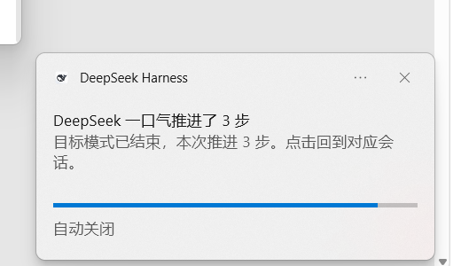

# Desktop Notifications (Windows Native Toast)

English | [中文](./README.md)

 [](https://github.com/game25011/dsh-notify-toast/actions/workflows/ci.yml)   

> When DeepSeek Harness is in the background, **Windows native toasts** remind you about questions and confirmations, approval requests, and finished root-session replies.
> When the DSH window is focused, the plugin stays completely silent; clicking a notification returns to DSH and opens the matching session when possible.
> No external network access; only a local loopback activation callback. No data collection, no cloud model calls, and no extra token usage.

- Package: `dsh-notify-toast` · Version: `0.3.0` · License: MIT
- Chinese display name: 桌面通知（Windows 原生 toast）; the npm package name, directory, and row id stay ASCII `dsh-notify-toast` (a documented naming exception).
- Works with: DeepSeek Harness Desktop `0.2.1-rc.2` (Electron shell, `desktop` profile), Windows 10/11
- Form factor: official DSH bundle (Host + Web Client), installed and removed through the official plugin manager
- Status: 0.3.0 native progress toast, automatic banner retraction, click-to-session, bar-only styling and a simple goal aggregation run verified on a real device (2026-10-21); goal edge cases remain to be re-tested; optional "rewrite the title when all tasks are done" remains available (default off)



## AI-assisted development

**Most of the code in this repository was produced with AI coding assistants.** Some tests, documentation, and copy were also AI-assisted. The human maintainer defined requirements, chose implementation approaches, debugged, designed tests, validated behavior, and managed releases, and remains responsible for the final code and its maintenance.

AI-generated content may contain errors or omissions; issues and pull requests are welcome. The project is released under the MIT License; AI tools are not the author, copyright holder, or responsible party. See [AI-DISCLOSURE.md](AI-DISCLOSURE.md).

---

## Features

| Capability | Behavior |
|---|---|
| Needs an answer / confirmation | Triggered by `user-questions/request`; title "DeepSeek has a question for you"; body is the first N characters of the question itself. |
| Needs approval | Triggered by `approval/request`; title "DeepSeek needs your approval"; body is "tool name · short purpose". |
| Reply finished | Triggered by `turn/end(completed)` from `session/event`; root sessions only, subagent completions never notify; one step: "DeepSeek finished a step"; 2–4 steps: "DeepSeek pushed N steps in one go"; 5+ steps: "DeepSeek went all out and pushed N steps"; body is the first valid paragraph of the last assistant reply, falling back to "Click to view". |
| Goal mode summary | While a goal is `active` and `armed`, per-round completions are suppressed. One summary is sent after `complete`, `paused`, `blocked`, the round limit, or `disarmed`, counting the Goal Round delta; paused/blocked use neutral titles. Questions/approvals still notify immediately. |
| Notify only when unfocused | Re-evaluates `document.hasFocus()` / `visibilityState` when an event arrives; no toast and no sound while focused. |
| Windows native progress toast | The Host uses a PowerShell/C#/WinRT helper to create a real Windows notification with a dynamic `<progress>` bar; it updates while the notification is displayed, stops at the approximate deadline, then hides the banner after a short grace; notification-center retention is still bounded by ExpirationTime. No custom in-app window. |
| Compatibility fallback | If the native helper cannot start or show, the plugin falls back to the Web Notification path; both are silent and the plugin plays the sound once. |
| Body length | Default 40 characters (Unicode code points), configurable 20–60; longer text is truncated with "…". |
| Privacy mode | Title only; body left empty. |
| Notification sounds | Four Web Audio–synthesized presets (Ding-dong / Chime / Bell / Soft tap) plus one CC0 open-source "Bubble" asset, volume 0–100, can be turned off and previewed; unlocked after the first user gesture; silent fallback on failure. |
| Click to return | The Host first raises the DSH window with Windows `SetForegroundWindow`, then the client opens the matching session when possible; falls back to `window.focus()` when koffi is unavailable. |
| Merging | Multiple "completion" events within 2.5 s (configurable) are merged into one toast to avoid notification bursts. |
| Automatic reply titles | Single step: "DeepSeek finished a step"; 2–4 steps: "DeepSeek pushed N steps in one go"; 5+ steps: "DeepSeek went all out and pushed N steps"; all-done: "All tasks are done". No custom title input. |
| Rewrite title when all tasks are done | Optional (default off): when several sessions run at the same time and all of them finish successfully, the session that finished last is renamed to the configured text; does nothing when only one session is running. |
| Settings page | DSH Settings → Notifications: enable/question/approval/reply-finished/goal-summary switches, notification display mode (native progress / compatibility), auto-remove delay, body length, privacy mode, sound (with preview), volume, merge interval, test notification/test system toast, and diagnostics. |
| Persistence | Official `ctx.settings` (volatile Config fields → profile patch); survives a DSH restart; no plugin-owned config file. |
| Degradation | Notification permission denied / unsupported environment / Host unavailable / `settings` missing / koffi load failure: no crash, and the settings page shows the status. |

### What this plugin does not do

Taskbar red dots, badges or numbers, session counters, persistent tray/background services; the PowerShell/C# toast helper only runs for the lifetime of a notification. No external network access, changes to DSH core, telemetry, or model calls.

---

## Installation

> Install this plugin only through the **official plugin manager**. Do not edit the profile's `package.json` or `cordis.patch.yml` by hand.

> Manifest note: `dsh-plugin.json` declares only the Host facet (`facets.host`); the Web Client half is declared by `dsh.client` in `package.json` (other third-party plugins use the same structure), so no `facets.client` is declared. Official DSH 0.2.1-rc.2 plugin loading is driven by `dsh.bundle` / `dsh.client` in `package.json`.

### Option A: In-app plugin manager (recommended)

1. Put the delivered `dsh-notify-toast-0.3.0.tgz` anywhere on the local machine (avoid spaces in the path).
2. Install it with the official plugin manager, either through the Agent or through the plugin management UI:
   - Agent tool: `plugin_manager` → `action: install_bundle`, `target: <absolute path to the tgz>`
   - CLI: only for self-managed profiles (web/headless). The official Desktop `desktop` profile is managed by the Electron application's plugin manager; use the UI or Agent method above.
3. After installation, confirm that `dsh-notify-toast` is enabled in Settings → Plugins.
   - **Restart DSH once after the first install/upgrade**: the official plugin manager can hot-insert the Host row, but already-loaded Host JavaScript modules only switch to the new code after a restart (client bundles hot-reload). The plugin never restarts the application itself.
4. Open Settings → Notifications and click "Send test notification". The "Runtime" block shows the Host connection, transport, settings persistence, and recent reminder counters.

### Option B: Development directory install (link)

```text
plugin_manager → install_bundle → target: <absolute path to the plugin directory>
```

Installing from a local directory creates a link, so DSH's HMR can pick up code changes; Host-side JavaScript changes may still require a restart if they are not hot-updated.

### Option C: Plugin market index

This repository ships `market-index.json`. Add this custom index in the DSH plugin market/discovery page:

```text
https://raw.githubusercontent.com/game25011/dsh-notify-toast/6278d8401ee91acba160e4187ac9ac07f54a4c57/market-index.json
```

Then search for `dsh-notify-toast` and install the pinned Git version.  
This is a **self-hosted index**; the default DSH market does not automatically list this plugin, so other users must add the same index or the official catalog must include it.

### Upgrade

- New tgz: run `install_bundle` again (the application prompts for a restart to load the new JS modules).
- Development directory: update the code in place; restart DSH when necessary.

### Uninstall

- In the application: disable/remove `dsh-notify-toast` in the plugin management UI.
- Agent tool: `plugin_manager` → `action: remove_bundle`, `target: dsh-notify-toast`.
- After removal: Host routes/event listeners/timers are released with the plugin fiber, the client bundle stops loading, and the settings-page entry disappears. Configuration entries already written to the profile patch no longer take effect (no background process or temporary files are left behind).

---

## Configuration

Location: **Settings → Notifications** (`settings.section`, id `dsh-notify-toast`).

| Setting | Range / options | Default | Notes |
|---|---|---|---|
| Notifications enabled | On/Off | On | Master switch; when off, nothing pops and nothing plays (except test notifications). |
| Questions & plan confirmation | On/Off | On | `user-questions/request` |
| Approvals | On/Off | On | `approval/request` |
| Reply finished | On/Off | On | One root-session reply; subagent completions never notify. |
| Summarize when a goal run ends | On/Off | On | Suppresses per-round goal completions; sends one summary after completion, pause, block, round limit, or disarm. Questions/approvals still notify immediately. |
| Body length | 20–60 characters | 40 | Truncated by Unicode code point with "…" when longer. |
| Privacy mode (title only) | On/Off | Off | The body is left empty. |
| Sound | Ding-dong / Chime / Bell / Soft / Bubble (open-source) / Off | Ding-dong | The first four are synthesized with Web Audio; Bubble is an embedded uisfx CC0 audio asset with no network request. A Preview button is available in the settings page. |
| Volume | 0–100 | 60 | 0 is effectively muted. |
| Merge interval | 0–10000 ms | 2500 | Completions within this window are merged into one toast. |
| Rename the last session when all finish | On/Off | Off | Optional rewrite-title behavior: takes effect only when at least two root sessions run concurrently and all finish successfully; a single running session does not trigger it. |
| Title text | 1–96 bytes | 所有任务均已完成 (All tasks completed) | The session that finishes last is renamed to this text when the all-done feature is on. |
| Notification display | Native progress / Compatibility | Native progress | Native mode shows a Windows notification with a progress bar; falls back to Compatibility when the helper is unavailable. |
| Auto-remove delay (approx.) | 3–30 seconds | 8 s | Controls when progress updates stop and the notification-center retention window; Windows controls the actual exit, so it may be earlier or later. |

All changes take effect immediately. Persistence uses the official DSH settings (volatile Config → profile patch layer), so settings survive a restart.

---

## How it works

```text
Host (lib/index.js)                                  Client (lib/client.js)
────────────────────────────────────────────         ────────────────────────────────────────────
approval/request ──────────────┐                     settings.section page (React, plain HTML)
user-questions/request ────────┼─ clean/truncate ──┐  ├─ focus check (hasFocus + visibilityState)
session/event turn/end ────────┘                    │  ├─ Web Notification(silent:true) + click to return
                                                    ▼  ├─ Web Audio synthesized sound + embedded CC0 Bubble asset
                                  event ring buffer + long polling ┘
Host browser route /dsh-notify-toast (official RPC envelope + same-origin fence)
  config / save / poll / health / test / focus
Host: ctx.settings (volatile Config) ← save
Host: koffi user32 SetForegroundWindow ← focus
```

- **Host detection**: listens directly to authoritative DSH events (approvals, questions, `turn/end`), reads the session log to extract the body, never calls a model, and never accesses the network.
- **Transport**: long polling under the `/dsh-notify-toast` prefix. It prefers the official `connection.rpc.handle`; on DSH 0.2.1-rc.2 that API has a bug (it reads `webServer` internally and throws `cannot get property "webServer" without inject`), so the plugin automatically falls back to a same-path `webServer` route and calls the official `connection.requestRejection` at the entry point to reuse the Host/Origin same-origin fence and browser signed-cookie authentication. Requests and responses use the official unary RPC envelope, so the client's `connection.rpc.call` code is unchanged. Settings → Host connection/transport shows the active path.
- **The client only presents**: focus is evaluated only when an event arrives; if the window is focused, the event is dropped (no toast, no sound).
- **Root-session check**: `SessionHeader.parentSession === undefined && origin !== 'subagent'`.
- **Body extraction**:
  - Question: the original `request.questions[0].question`.
  - Approval: the tool name plus a short purpose from `displayReason`/`reason`.
  - Completion: walk back from the `turn/end` event to the nearest `assistant/message`, take its text blocks, strip Markdown/code fences/inline code/links/heading markers, collapse whitespace, and take the first paragraph; if there is no usable text → "Click to view".
- **Click to return**: the client posts (RPC) `focus` → the Host uses DSH's bundled koffi (`resources/app.asar.unpacked/.../koffi.node`) to call user32 `ShowWindow/SetForegroundWindow/AttachThreadInput` and raise the Electron main window; the client then calls `window.focus()` and opens the matching session.
- **Configuration persistence**: every `Config` field is `.volatile()`; the Host resolves `@deepseek-ai/schemastery` from the profile (preferring `DSH_PROFILE_DIR`, then the Host process cwd, i.e. the profile directory, then the copy inside the DSH installation) and reads/writes the current profile patch through `ctx.settings.describe()/update()`. Settings → settings persistence/configSource shows the status.

### Privacy

- No external network access; only a local loopback activation callback. No reporting, no collection, no model calls; toast bodies come only from content already present in the local session log.
- No plugin-owned config files; configuration is persisted by the official DSH settings into the profile patch.
- Notification content may contain reply excerpts: enable "Privacy mode (title only)" if you mind.

---

## Compatibility

| Item | Notes |
|---|---|
| DSH | `0.2.1-rc.2` (`engines.dsh: >=0.2.1-rc.2 <0.3.0`); the Host event/RPC/settings contracts this plugin relies on were tested on this version. |
| Operating system | Windows 10/11 (native toast + koffi user32 window focus); macOS/Linux untested (the plugin targets Windows). |
| Runtime form | DSH Desktop (Electron, page origin `dsh-app://app`). Under a regular browser Web profile toasts still work, but "raise the Windows window" degrades to focusing the browser itself. |
| Notification permission | The Windows notification center must allow notifications for the application; Electron Desktop grants non-media permissions by default. If disabled by the OS or group policy, the plugin degrades without crashing. |
| Focus assist | Windows Focus Assist / Do Not Disturb may suppress toasts silently (OS behavior; the plugin cannot bypass it). |

---

## Known limitations

1. The page must stay open (minimizing the DSH window is fine, but the page process must not exit); if the browser is closed, there are no notifications.
2. If notification permission is denied or the system does not support Web Notification: the settings page shows the status and native toasts are unavailable (sound and click-to-return still work); no crash.
3. If Windows notification banners are turned off or Focus Assist is on, native toasts may go only to the notification center without a banner; the "System toast" counters and "Test system toast" in the settings page help confirm this — allow notifications for the application in Windows Settings and turn off Focus Assist.
4. The first sound needs one user gesture on the page (Chromium autoplay policy); before it is unlocked, sound is silent while notifications still appear.
5. Raising the window on click depends on the koffi native module bundled with DSH; if the module path changes or loading fails, the plugin falls back to `window.focus()`, which may not raise the window but still opens the session.
6. With multiple windows/tabs, a localStorage lease (5 s heartbeat, 15 s expiry) lets only one window show toasts/play sound; under extreme lease contention, brief duplicate notifications are possible.
7. Subagent completions never notify; questions/approvals from subagents still notify (they block tasks just the same).
8. The "completion" body takes the first paragraph of the last assistant reply; if the reply only contains code/tool calls, the body falls back to "Click to view".
9. Merging applies only to completions; questions/approvals are never merged (you need to handle them promptly).
10. Windows controls the native toast exit animation and banner lifetime; the approximate auto-remove delay stops progress updates and bounds notification-center retention, not an exact banner duration. After a short grace the helper calls `Hide()` to retract the banner; the visual transition still belongs to Windows.
11. Click-to-session on a native progress toast depends on the local activation callback; if the callback fails, the toast may only close without opening the session. The toast no longer uses the `dsh://open` protocol launch, avoiding a second DSH instance/session.
12. The native helper writes a small C# DLL cache under `%LOCALAPPDATA%\dsh-notify-toast\native-cache` on first use; if compilation or PowerShell/WinRT is unavailable, the compatibility path is used.
13. The plugin does not modify DSH core; if a DSH upgrade changes the event/RPC/settings contracts above, the plugin may need a matching update.
14. The official `connection.rpc.handle` in DSH 0.2.1-rc.2 has a bug (`cannot get property "webServer" without inject`); the plugin already falls back to the same-path route plus the official `connection.requestRejection` fence. This does not change client behavior, but once DSH fixes that API the plugin will prefer the official channel.

---

## Troubleshooting

| Symptom | What to check |
|---|---|
| No toast at all | Settings → Notifications: check the "Notification permission / Host connection / System toast" status; click "Test system toast". If it reports "created" but no banner appears, open Windows Settings → System → Notifications, enable banners and turn off Focus Assist; also check whether the notification is in the notification center (Win+N). |
| Sound but no popup | Same as above; also make sure the application's notifications are not set to "notification center only". |
| No toast while focused | By design (no interruptions while focused); switch focus to another application or use "Send test notification" to verify. |
| Toast but no sound | Settings → Notifications → "Preview"; check whether "Sound engine" says "ready" (click the page first if it says "locked"); check the application's volume/mute in the Windows Volume Mixer and the system output device; check whether volume is 0 or sound is off. |
| Clicking the notification does not return to DSH | Check whether "Window activation" is available in the settings page; when unavailable, the plugin is in degraded mode. |
| Settings lost after restart | Check whether "Settings persistence" says "official settings"; if it shows a degraded state, `ctx.settings` is unavailable (the plugin still works with defaults). |
| No entry in the plugin list | Confirm with the official plugin manager that the bundle is installed and enabled; restart DSH if necessary. |

---

## Development and testing

```text
Command                                      Description
npm test                                     Unit tests for text cleanup/truncation, config, merging, titles, goal aggregation and native lifecycle (94 tests)
npm run smoke                                Smoke test that simulates __ModuleLoader__ loading client.js (25 tests)
npm run probe                                RPC probe: --self-check runs pure-function checks (7 checks); --url probes the host RPC route (expects 401/403 without a cookie)
node scripts/host-probe.mjs <profileDir>     Host integration probe (real profile cwd)
npm pack                                     Build the delivery tgz
```

- Source layout:
  - [`lib/index.js`](lib/index.js) — Host half (events, browser route, settings, merging, cleanup)
  - [`lib/text.js`](lib/text.js) — pure text cleanup/truncation helpers (unit-tested)
  - [`lib/config.js`](lib/config.js) — defaults/validation/merge/volatile Config schema
  - [`lib/native-focus.js`](lib/native-focus.js) — koffi user32 window focus
  - [`lib/client.js`](lib/client.js) — Web client half (focus, toasts, sound, settings page, long polling)
  - [`locale/zh.json`](locale/zh.json), [`locale/en.json`](locale/en.json) — plugin marketplace/settings-page display metadata
  - [`scripts/client-smoke.mjs`](scripts/client-smoke.mjs), [`scripts/probe-rpc.mjs`](scripts/probe-rpc.mjs) — smoke tests/probes
  - [`dsh-plugin.json`](dsh-plugin.json) — plugin manifest (Host facet, public id `dsh.notify-toast`); the Web Client half is declared by `dsh.client` in `package.json`; `cordis.patch.yml` is the bundle patch
  - [`docs/PLAN.md`](docs/PLAN.md) — historical 0.1 plan, not shipped in the npm package; [`docs/INTERFACE.md`](docs/INTERFACE.md) — Host/Client contract; [`docs/TEST-REPORT.md`](docs/TEST-REPORT.md) — acceptance record; [`docs/RELEASING.md`](docs/RELEASING.md) — release manual

Project repository: https://github.com/game25011/dsh-notify-toast. See [CONTRIBUTING.md](CONTRIBUTING.md) for the development workflow, [SECURITY.md](SECURITY.md) for private vulnerability reporting, and [CODE_OF_CONDUCT.md](CODE_OF_CONDUCT.md) for community expectations.

---

## Acknowledgements

Implementation ideas were informed by the following MIT-licensed open-source plugins (the code is original; no whole sections were copied):

- [chromoany/dsh-notify-me](https://github.com/chromoany/dsh-notify-me) — focus detection, notification degradation, settings page, multi-window leader
- [BillCx330/dsh-plugin-notify-sounds](https://github.com/BillCx330/dsh-plugin-notify-sounds) — koffi user32 window focus, Connection route fence
- [Laplace-bit/dsh-bell-notify](https://github.com/Laplace-bit/dsh-bell-notify) — Web Audio synthesized sounds
- [uisfx](https://github.com/romainsimon/uisfx) — CC0 source of the Bubble sound; see [THIRD_PARTY_NOTICES.md](THIRD_PARTY_NOTICES.md)

## License

MIT, see [LICENSE](./LICENSE).

## Disclaimer

This is an unofficial community plugin for DeepSeek Harness. It is not affiliated with, endorsed by, or sponsored by DeepSeek. **Not affiliated with DeepSeek.** DeepSeek, DeepSeek Harness, and other marks are trademarks of their respective owners.
